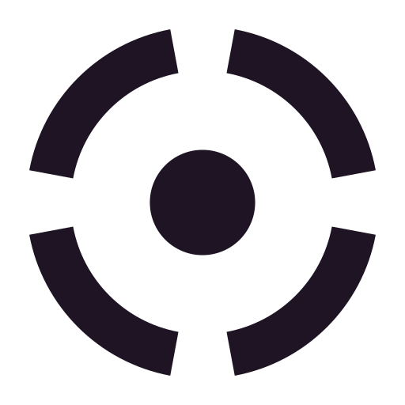

# Pirs

<picture>
  <source media="(prefers-color-scheme: dark)" srcset="docs/brand/lockup.svg">
  
</picture>

Pirs is an experiment in making an AT Protocol personal data server (PDS)
extensible. It has two parts: a draft specification of the hook points a PDS
offers to plugins, and a fork of the Bluesky PDS distribution that implements
them.

It is experimental research software and not for production use. The
specification is a working draft and nothing in it is stable.

## Features

- **Hook-point specification.** [docs/spec/hook-points.md](docs/spec/hook-points.md)
  defines four levels (observe, serve, act, decide), the hooks at each level and
  a capability vocabulary, written so other PDS implementations could adopt it.
- **Sandboxed plugin host.** A separate Rust process runs plugins as WIT
  (WebAssembly component) modules with Wasmtime. Plugins never run inside the
  PDS and never receive signing keys. The host enforces memory, deadline,
  response and log limits and recovers after a plugin traps or loops.
- **Manifests.** A plugin's manifest is checked against the component's imports
  at install, and each capability is checked again on every call.
- **Event delivery.** An opt-in bridge delivers retained PDS events (commits and
  account events) to the host with a resumable cursor.
- **Outbound requests** only to hosts the manifest allows. Private, loopback,
  link-local and metadata addresses are refused, and only ports 80 and 443 are
  allowed.
- **XRPC methods** served by plugins through authenticated service proxying.
- **HTTP routes** served by plugins on a separate origin from the PDS.
- **Public reads** of records and blobs from plugins.
- **Key-value storage** per plugin, with a quota.
- **Reference plugins:** a static site plugin that serves pages from records in
  one account's public repository, and a commit webhook plugin.
- **Status endpoint.** The bridge adds `GET /_pirs/status` to the PDS and counts
  sequencer events.

The PDS itself is the upstream Bluesky distribution with one hook
(`PdsHooks.xrpcMiddleware`) added through a pinned patch package in
`service/pirs/pds-patches/`. The patched `@atproto/pds` source lives in the
[pirs-atproto](https://github.com/subculture-collective/pirs-atproto) fork.

## Quick start

The smoke check needs Node.js 22 or later and pnpm.

```sh
cd service
pnpm install --frozen-lockfile
pnpm smoke
node --test pirs/smoke.test.ts
```

`pnpm smoke` boots a throwaway PDS and a local PLC fixture with a temporary data
directory and generated secrets, creates an account, writes a record, and
checks that the bridge receives the events. The PDS listens on
`127.0.0.1:2597`; set `PIRS_SMOKE_PORT` to change it.

Other checks in `service/`:

```sh
pnpm check:events && pnpm qualify:events   # event delivery and cursor restart
pnpm check:xrpc && pnpm qualify:xrpc       # plugin XRPC methods
```

The plugin host needs Rust 1.95, Python 3.11 or later and Linux. See
[service/pirs/host/README.md](service/pirs/host/README.md) for the build and
its test scripts.

To build and boot the container image locally, commit your changes and run
`bash service/pirs/container-smoke.sh` from the repository root. It builds the
committed snapshot with the Dockerfile, starts the PDS on loopback with
generated secrets, checks health and bridge status, and removes the container.

## Configuration

The PDS uses the upstream `PDS_*` environment variables; `sample.env` lists
them. The smoke check generates its own values. Plugin limits (memory,
deadline, response, log and input size) are flags on the host process; see the
host README.

## Deploy

Pirs is not ready to deploy. The `Dockerfile` builds a PDS image from
`service/` the same way upstream does. `installer.sh`, `compose.yaml`,
`sample.env`, `pdsadmin/` and [PUBLISH.md](PUBLISH.md) come from the upstream
distribution and install the unmodified upstream image.

## Project layout

- `docs/spec/`: hook-point specification and capability specs
- `docs/decisions/`: design decisions, including the choice of WIT components
- `docs/roadmap.md`: milestones by hook level
- `service/pirs/bridge.ts`: the code that attaches to the PDS
- `service/pirs/host/`: Rust plugin host, fixtures and reference plugins
- `service/pirs/events/`: event transport and durable consumer cursor
- `service/pirs/xrpc/`, `http/`, `public-read/`, `static-site/`: plugin
  serving and reads
- `service/pirs/pds-patches/`: the pinned patched PDS package
- everything else: the upstream Bluesky PDS distribution
  ([UPSTREAM-README.md](UPSTREAM-README.md))

## Tracking upstream

Pirs code lives in `service/pirs/` and `docs/`, with small changes to
`service/index.ts` and `service/package.json`, so upstream merges stay small.

```sh
git remote add upstream https://github.com/bluesky-social/pds.git
git fetch upstream
git merge upstream/main
cd service && pnpm install --frozen-lockfile && pnpm smoke
```

See [docs/upstream-merge.md](docs/upstream-merge.md) for the merge procedure.

## Contributing

Report bugs and request features in [GitHub issues](https://github.com/subculture-collective/pirs/issues).
Ask questions and share ideas in [GitHub Discussions](https://github.com/subculture-collective/pirs/discussions).

Send code as a pull request on GitHub against `main`. On every pull request, CI
builds the stock and patched PDS packages, runs the smoke and event checks
against each, builds the plugin host and reruns the plugin interface
measurements.

## License

Upstream code is dual-licensed under MIT and Apache-2.0; see
[LICENSE.txt](LICENSE.txt), [LICENSE-MIT.txt](LICENSE-MIT.txt) and
[LICENSE-APACHE.txt](LICENSE-APACHE.txt). Pirs additions are offered under the
same terms.

Built by [SUBCULT](https://subcult.tv).
